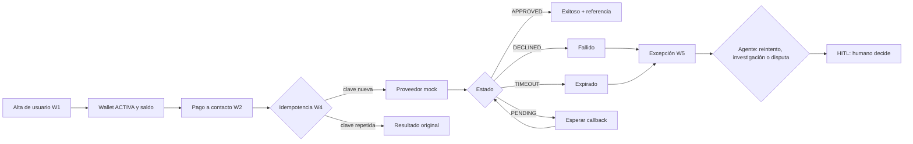

## Resumen
Recorrido mínimo: Alta → Wallet → Pago → Estado → Excepción. El agente (Crew) interpreta, recomienda, explica y escala con HITL.

## Recorrido paso a paso
| # | Paso | HU | Qué hace el sistema | Agente interviene | Real / Mock |
|---|---|---|---|---|---|
| 1 | Alta de usuario | W1 | Guía los pasos, valida datos, emite eventos | Explica el siguiente paso | Real; KYC/OTP mock |
| 2 | Wallet activa y saldo | W1 | Cambia a ACTIVA y habilita el pago | — | Real |
| 3 | Pago a contacto (celular o alias) | W2 | Muestra destino y monto, valida RN-01, envía | Interpreta la intención | Real; proveedor mock |
| 4 | Idempotencia | W4 | Detecta la clave repetida y devuelve el original | — | Real |
| 5 | Estado | W2 | Muestra un único terminal; PENDING espera callback | Explica el estado | Real; callback mock |
| 6 | Excepción y recuperación | W5 | Clasifica el motivo y la ruta (reintento, investigación, disputa) | Recomienda y explica | Real; reverso mock |
| 7 | Decisión crítica | W5 | Escala a un humano | Escala con HITL | — |

Pago a comercio por QR (W3) usa el mismo motor con `channel = QR` y es stretch.

## Diagrama

## Decisiones pendientes
- Ninguna.

## Siguiente paso para el rol consumidor
Presenter: usar este flujo como guion de la demo en vivo, con una excepción incluida.
