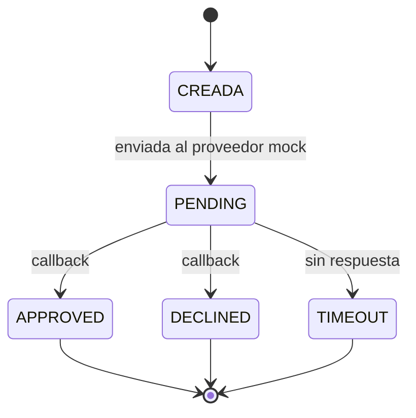

## Resumen
Define los estados de la wallet y de la transacción, y cómo el estado del proveedor mock se traduce al estado terminal que ve el usuario. Los nombres de estado son PROPUESTOS.

## Estados de wallet
| Estado | Significado | Transición |
|---|---|---|
| PENDIENTE_ONBOARDING | Usuario registrado sin onboarding finalizado | → ACTIVA al finalizar W1-AC3 |
| ACTIVA | Puede acceder al pago de bajo monto (RN-10) | — |

## Estados del proveedor mock → estado terminal del usuario (RN-05)
| Estado del proveedor | Terminal | Etiqueta al usuario | Siguiente acción |
|---|---|---|---|
| APPROVED | Sí | exitoso | Mostrar referencia (RN-11) |
| DECLINED | Sí | fallido | Reintentar o volver (RN-12) |
| TIMEOUT | Sí | expirado | Reintentar o volver (RN-12) |
| PENDING | No | (en proceso) | Esperar el callback; no es resultado final (RN-07) |

Las etiquetas "exitoso/fallido/expirado" vienen de W2-AC2; su texto final está por definir con producto.

## Ciclo de una transacción

## Eventos que no son estados
| Evento | Efecto | Regla |
|---|---|---|
| Solicitud duplicada (misma clave) | Devuelve el resultado original; se registra con identificador de solicitud y de correlación | RN-13, W4-AC3 |
| Callback duplicado | No cambia el estado ya terminal; se registra | RN-13 |

## Ruta de atención de un pago no exitoso (W5)
| Ruta | Cuándo | Regla |
|---|---|---|
| Reintento | Falla técnica sin transferencia ejecutada | RN-15 |
| Investigación | Estado incierto (por ejemplo, TIMEOUT con duda de ejecución) | RN-15 |
| Disputa | Transferencia ya ejecutada | RN-15, SUP-11 |

## Decisiones pendientes
- PA-03: conjunto mínimo de estados para el comercio (W3, stretch).
- PA-05: categorías de disputa.

## Siguiente paso para el rol consumidor
AI Engineer A: modelar estos estados en el dominio. Arquitecto/a: decidir cómo se persisten.
